<div align="center">

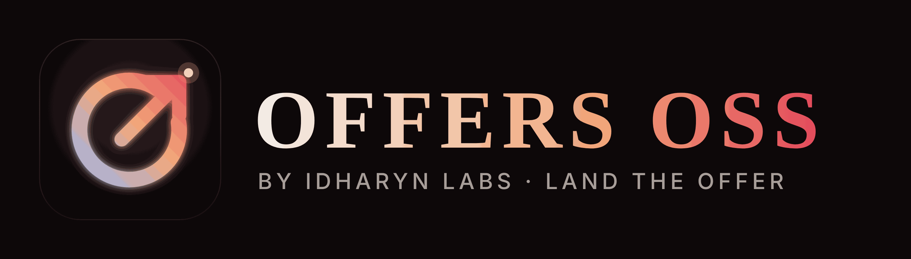

### The job-hunt operating system that works with *any* AI, and keeps you in control.

**Score jobs locally · tailor with any AI on a ~450-token packet · track everything in Excel · see it all on a live dashboard**
**No bots. No scraping. You click Submit.**

[](#-tests)
[](#-60-second-quick-start)
[](docs/RECOMMENDED_AI.md)
[](docs/COMPLIANCE.md)
[](LICENSE)

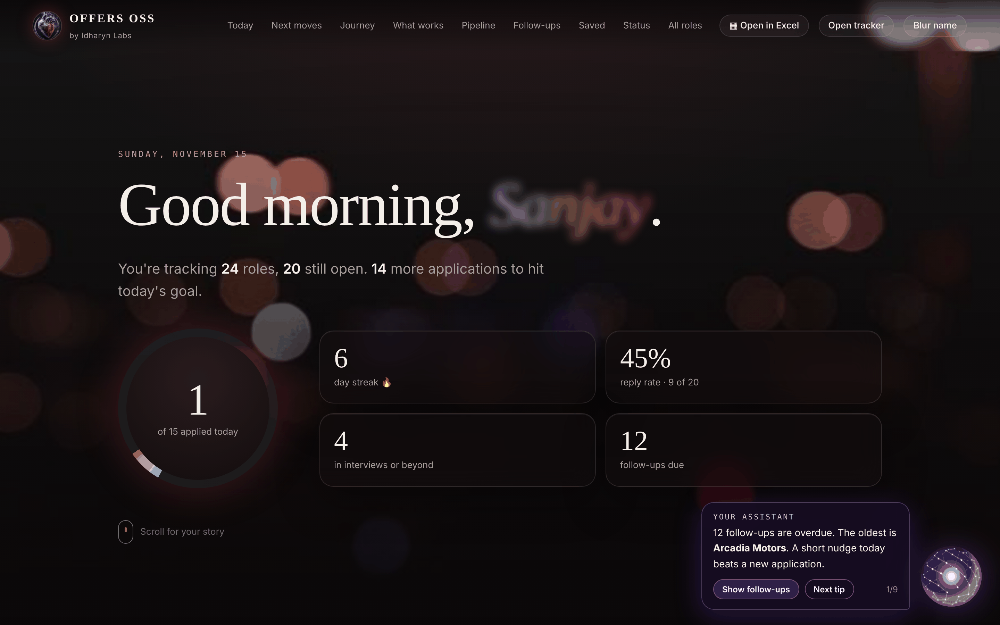

<sub>Real dashboard with demo data. Name blurred with the built-in <b>Privacy blur</b> button.</sub>

</div>

---

## Why Offers OSS

Auto-apply bots promised "1,000 applications in 2 days". In practice they get accounts restricted, flood recruiters, and get filtered out by ATS knockout questions. Doing it by hand doesn't scale either: 30–60 minutes per application, a messy spreadsheet, forgotten follow-ups.

Offers OSS does it differently:

| | |
|---|---|
| 🎯 **Precision over volume** | Every JD is scored against *your* skills locally (0 AI tokens), so you apply top-down to roles you can actually win. |
| 🪙 **About 80% fewer tokens** | The AI never sees your whole resume or the whole JD, just a compact *packet*: facts + job card + filtered requirements. |
| 🧠 **Answer once, reuse forever** | A second brain stores your answers to the 24 questions job sites always ask. Forms take seconds. |
| 🕹️ **You stay in control** | One command (`go`), numbered choices, and nothing is sent without you. |
| 📊 **Everything counted** | Daily goal ring, streak, replies, interview rate, tokens saved, time saved, brain coverage. All live. |
| 🛡️ **Compliant by design** | No auto-submit, no scraping, no login automation, no invented facts. [Read why](docs/COMPLIANCE.md). |

---

## 🎯 What Offers OSS does

It covers the whole path from "I found a job" to "I got the offer":

| Stage | What happens | Command |
|---|---|---|
| **1. Find & choose** | Each job you paste is scored against your skills locally, de-duplicated and matched to the best resume variant | `import` · `triage` |
| **2. Apply** | Any AI tailors your resume top-third, cover note and recruiter message from a small packet. **You** click Submit | `packet` |
| **3. Track** | Every status change is written to Excel, with the follow-up date set automatically | `status` · `open` |
| **4. Review** | The dashboard tells the story: funnel, best sources, complete status, health score, and an assistant that says what to check next | `export` |
| **5. Follow up & prepare** | Overdue nudges, ghost detection, interview prep packs | `due` · `packet --task interview-prep` |
| **6. Learn** | Answers to common questions, interview questions and rejection reasons are saved and reused | `brain` · `answer` · `learn` |

## 🔗 Excel ⇄ Dashboard: one source of truth

```
offeros add / import / status / learn ──writes──▶  tracker/OffersOSS_Tracker.xlsx  ◀── you can edit it by hand too
                                                        │
                              offeros export  (or drag the .xlsx onto the page)
                                                        ▼
                                              dashboard/index.html ──"Open in Excel" + "Applications!A7" on every job──┐
                                                        ▲                                                              │
                                                        └──────────────────────────────────────────────────────────────┘
```

- **Excel layout:** `Dashboard` (live formulas) · `Applications` (16 columns, drop-downs, colour rules) · `Lists` (statuses and sources the dashboard reads) · `Guide`.
- `python offeros.py open OF-0007` opens the tracker and tells you the row.
- Excel links work when you open the dashboard from your own computer. Browsers block local-file links on hosted pages.

## ⚡ 60-second quick start

```bash
git clone https://github.com/<you>/offeros && cd offeros
pip install -r requirements.txt
python offeros.py setup        # 6 questions -> profile, tracker, second brain ready
python offeros.py brain        # answer common job-site questions once (Enter = skip)
python offeros.py go           # your daily cockpit
```

Just want to look around? `python scripts/seed_demo.py && python offeros.py export`, then open `dashboard/index.html`.

Don't code? Use the **[no-code path](docs/SETUP.md#b-no-code-excel--any-ai-chat)**: the Excel template plus `AGENTS.md` pasted into any AI chat.

---

## 🖼️ See it work

<table>
<tr><td width="50%">

**1 · Setup in one go**
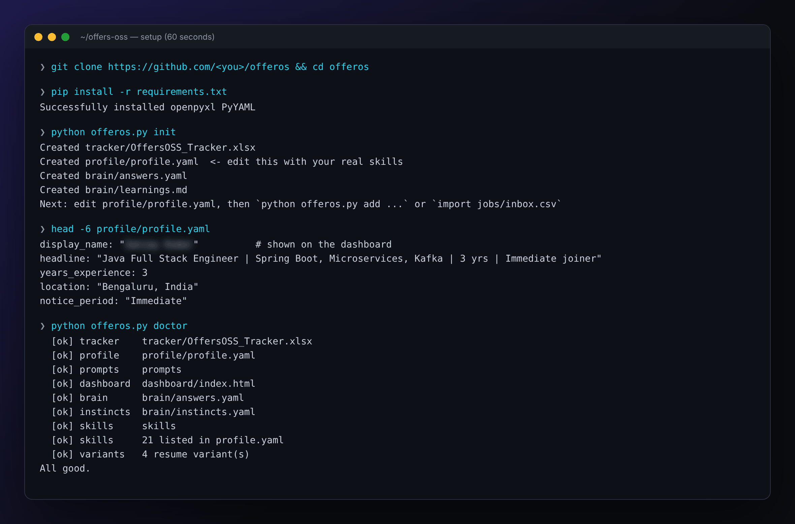

</td><td width="50%">

**2 · Import & triage: zero tokens**
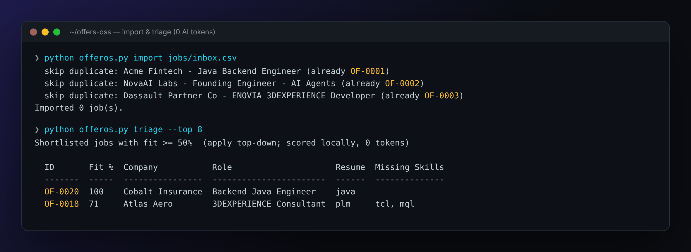

</td></tr>
<tr><td>

**3 · Token-lean packet for any AI**
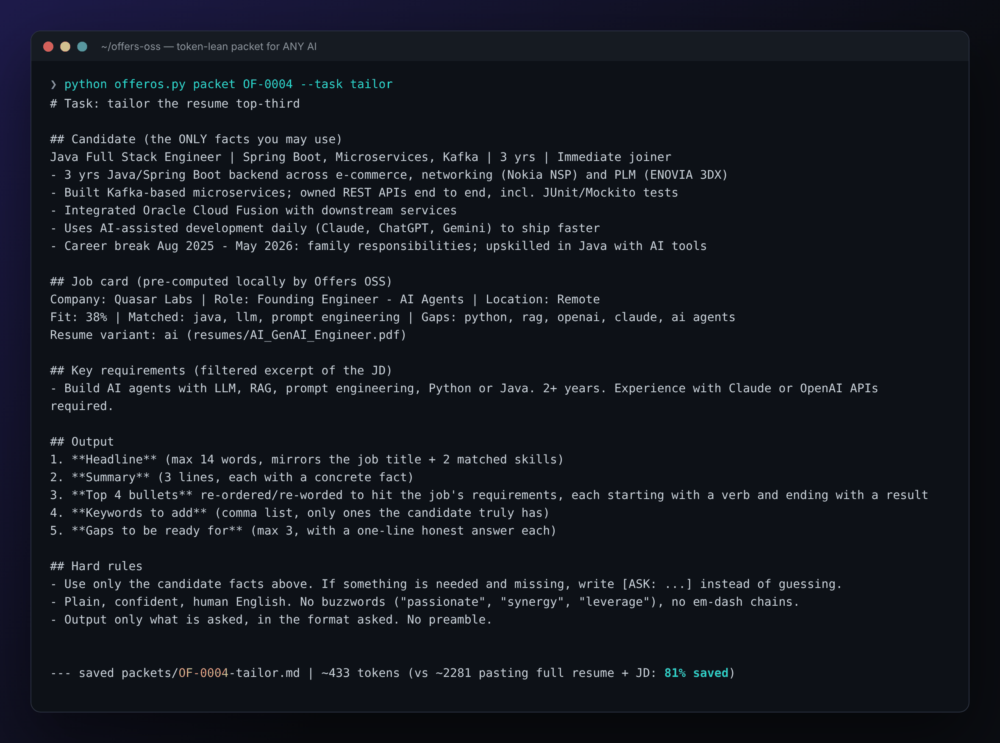

</td><td>

**4 · Daily cockpit: one command, numbered choices**
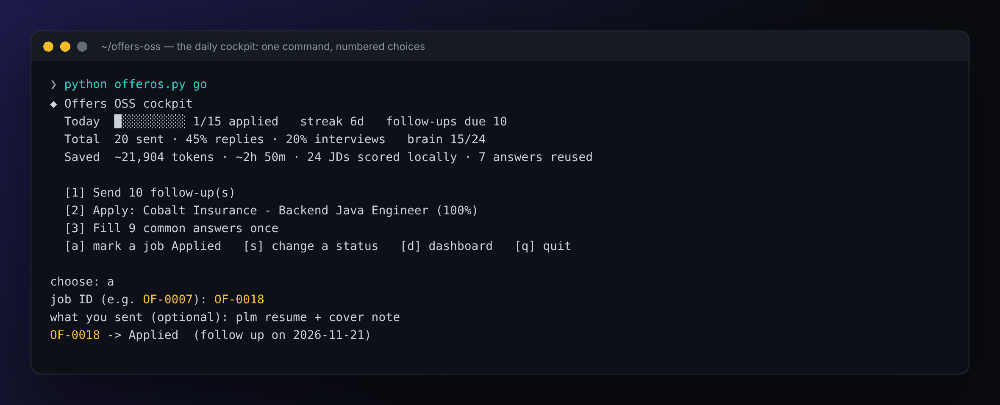

</td></tr>
<tr><td>

**5 · Fill the questions job sites ask, once**
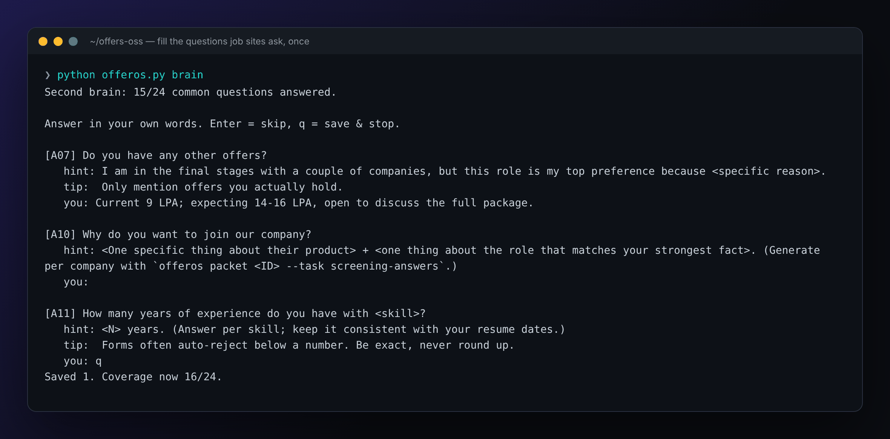

</td><td>

**6 · Second brain answers in milliseconds**
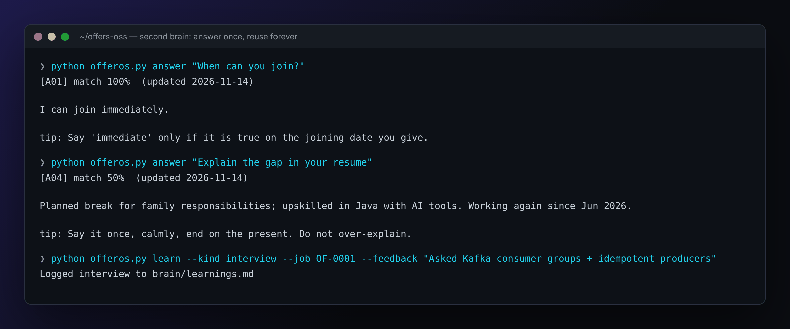

</td></tr>
<tr><td>

**7 · Excel is the source of truth**
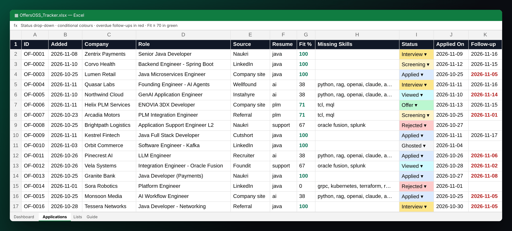

</td><td>

**8 · Status, follow-ups, stats**
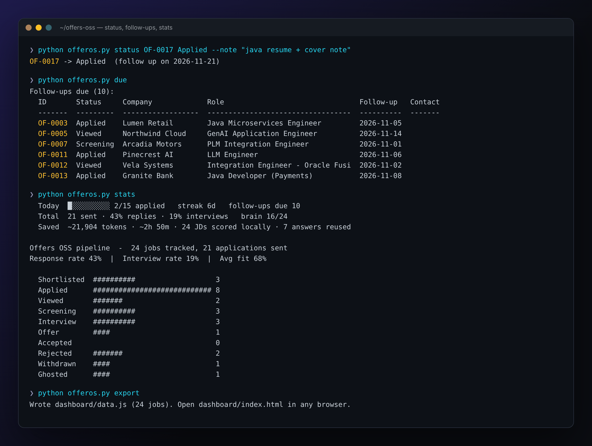

</td></tr>
</table>

<details><summary><b>Full dashboard story</b></summary>

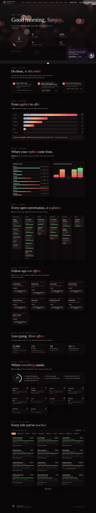
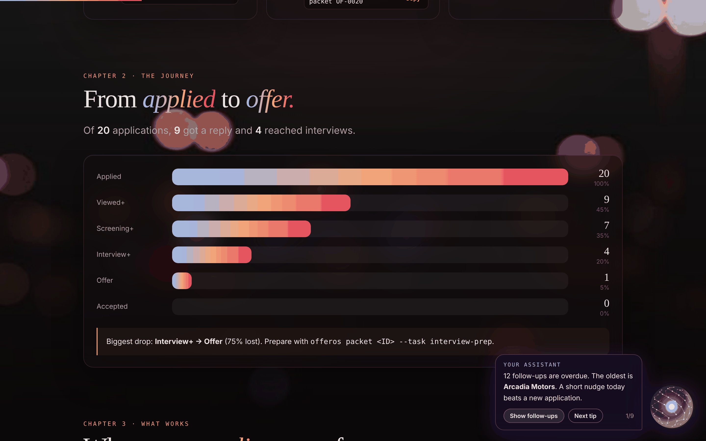
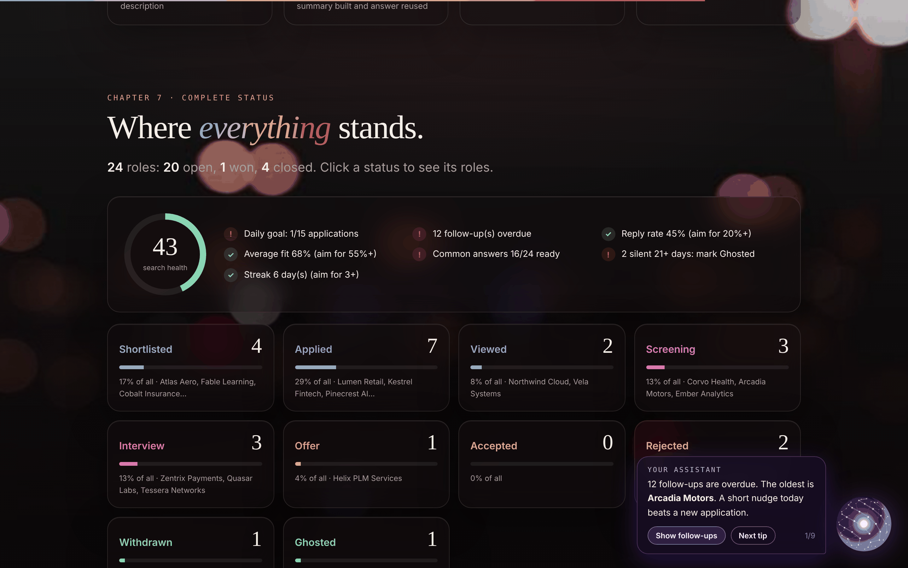
</details>

---

## 🧭 How it works

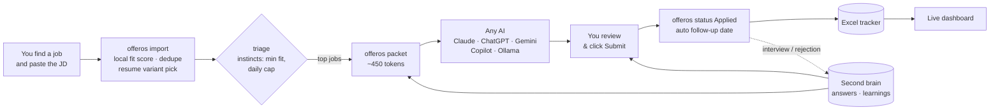

**Three layers, one rule:** the CLI does the counting (free), the AI does the writing (cheap), and you do the deciding.

---

## ✨ Features

| Area | What you get |
|---|---|
| **Setup** | `setup` asks 6 questions and pre-fills your second brain. `doctor` checks everything. |
| **Cockpit** | `go` shows today's goal bar, streak, follow-ups due and the next best actions as numbered choices. |
| **Local scoring** | Fit % from matched vs missing skills, must-have and deal-breaker caps, experience-gap flags. Multi-word skills and aliases (`spring boot\|springboot`), no false hits (`go` won't match `golang`). |
| **Resume routing** | Each JD is routed to the best of your resume variants (e.g. Java / AI / PLM / Support). |
| **Packets** | 6 AI tasks: `tailor`, `cover-note`, `recruiter-message`, `screening-answers`, `follow-up`, `interview-prep`. Each prints its token estimate and saving. |
| **Second brain** | `answer` (fuzzy match, 0 tokens), `brain` (fill unanswered questions one by one), `learn` (save answers, interview questions, rejection reasons). |
| **Instincts** | `brain/instincts.yaml`: min fit, daily cap, follow-up cadence, ghosting rule, and 10 senior-recruiter rules every AI must obey. |
| **Skills** | 6 portable `SKILL.md` playbooks: daily run, triage, tailor, browser assist, second brain, interview prep. |
| **Tracker** | `OffersOSS_Tracker.xlsx`: drop-downs, status colours, red overdue follow-ups, green high-fit, and a formula-driven Dashboard sheet. Print-ready. Every CLI command updates it; `python offeros.py open [ID]` opens it, and the dashboard has an **Open in Excel** button plus an `Applications!A<row>` reference on every job. |
| **Dashboard** | One HTML file: an 8-chapter story, a complete status page with a health score, and an animated AI-sphere assistant that tells you what to check next. Animated counters, goal ring, funnel, source performance, fit spread, kanban, follow-ups, searchable list, copy-command buttons, scroll animations, **privacy blur**. Open it from disk, or drag your `.xlsx` onto it. |
| **Follow-ups** | Auto-dated on status change (Applied +7d, Viewed +4d, Screening +3d, Interview/Offer +2d). `due` lists them and flags ghosted roles after 21 days. |
| **Counters** | Tokens saved, minutes saved, JDs scored, answers reused, streak, brain coverage. Shown in `go`, `stats` and the dashboard. |
| **Any AI** | `AGENTS.md` (universal) + `CLAUDE.md`, `GEMINI.md`, `.github/copilot-instructions.md`, `.claude/skills`. |
| **Privacy** | Local-first. All personal files are git-ignored. Packets carry no phone, email or address. |

---

## 🤖 Works with any AI

| You use… | How |
|---|---|
| **Claude** (recommended for writing) | Paste a packet, or open the repo in **Claude Code**: it reads `CLAUDE.md` + `skills/`. **Claude in Chrome** fills forms on a page you opened and stops before Submit. |
| **ChatGPT** | Create a Project, paste `AGENTS.md` as instructions, upload your profile and brain files. |
| **Gemini** | Same with a Gem, or **Gemini CLI** in the repo (reads `GEMINI.md`). Good for long JDs. |
| **Copilot / Cursor** | Reads `.github/copilot-instructions.md` / `AGENTS.md`. |
| **Ollama (offline)** | Paste packets into any local model. Nothing leaves your machine. |

Full matrix and a token budget: **[docs/RECOMMENDED_AI.md](docs/RECOMMENDED_AI.md)**

### Token math (typical day, 10 applications)

| | Naive | Offers OSS |
|---|---:|---:|
| Score 30 JDs | ~75,000 | **0** |
| Tailor 10 jobs | ~40,000 | **~4,500** |
| 20 screening answers | ~6,000 | **0** (saved answers) |
| Follow-ups, stats, dashboard | ~5,000 | **0** |
| **Total** | **~125k** | **~5–8k** |

<sub>Estimates at ~4 characters per token. `offeros packet` prints the real number for each packet.</sub>

---

## 🧠 Second brain: the questions job sites will ask you

Run `python offeros.py brain` once. Each answer you give is reused on every form (`offeros answer "<field label>"`, 0 tokens). These are pre-loaded, with hints and traps to avoid:

<details open><summary><b>24 suggested questions (Naukri, LinkedIn, Indeed, Instahyre, Workday, Greenhouse, Lever)</b></summary>

| # | Question | # | Question |
|---|---|---|---|
| A01 | Notice period / when can you join? | A13 | Current location |
| A02 | Current and expected CTC | A14 | Comfortable commuting / work from office? |
| A03 | Why are you looking for a change? | A15 | Rotational / night shifts? |
| A04 | Explain the gap in your career | A16 | Expected date of joining |
| A05 | Open to relocation / hybrid? | A17 | LinkedIn / GitHub / portfolio URL |
| A06 | Tell me about yourself | A18 | Rate your proficiency in X (1–10) |
| A07 | Any other offers? | A19 | Worked for this company or its clients before? |
| A08 | Years of experience in Java / X | A20 | Valid passport / willing to travel? |
| A09 | Work authorisation / visa sponsorship | A21 | Serving notice? Last working day? |
| A10 | Why do you want to join us? | A22 | Why should we hire you? (2–3 lines) |
| A11 | Years of experience with \<skill\> | A23 | Contract, C2H or full-time? |
| A12 | Highest education | A24 | Certifications? |

</details>

New question on a form? Answer it once, then `python offeros.py learn --q "<question>" --a "<answer>"`. After every interview: `offeros learn --kind interview --job OF-0007 --feedback "asked X, Y"`. Your future prep packs use it.

---

## 🛡️ Compliance at a glance

LinkedIn does not permit third-party bots or extensions that automate activity on its site ([source](https://www.linkedin.com/help/linkedin/answer/a1341387)), and Indeed's terms prohibit automating Indeed Apply outside its official tooling. Offers OSS is built around that:

✅ scores JDs you paste · ✅ drafts text you review · ✅ fills fields on a page *you* opened, then stops · ✅ local-first, git-ignored personal data
❌ no auto-submit · ❌ no scraping · ❌ no login or CAPTCHA automation · ❌ no mass messaging · ❌ no invented facts

Details, privacy (DPDP Act 2023 / GDPR) and AI-provider notes: **[docs/COMPLIANCE.md](docs/COMPLIANCE.md)**

---

## 🆚 How it compares

| | Offers OSS | AIHawk | ApplyPilot | ai-job-search |
|---|:-:|:-:|:-:|:-:|
| Works with any AI (incl. no-code chat & offline) | ✅ | OpenAI-style APIs | Gemini/OpenAI + Claude Code | Claude Code |
| Auto-submits applications | ❌ by design | moved to a hosted product | ✅ | ❌ |
| Scrapes job boards | ❌ | ✅ | ✅ | ❌ |
| Local, zero-token fit scoring | ✅ | ❌ | ❌ | ❌ |
| Excel tracker + formula dashboard | ✅ | ❌ | ❌ | ❌ |
| Live HTML dashboard (no server) | ✅ | ❌ | ❌ | ❌ |
| Second brain for screening questions | ✅ 24 pre-loaded | ❌ | ❌ | partial |
| Follow-up scheduling & ghost detection | ✅ | ❌ | ❌ | ❌ |
| Multi-resume routing | ✅ | ❌ | ❌ | ❌ |
| India job sites in mind (Naukri, Instahyre, Cutshort) | ✅ | ❌ | ❌ | ❌ |

<sub>Based on each project's public README as of Nov 2026. AIHawk's README says its auto-apply feature is no longer open source. Corrections welcome via PR.</sub>

---

## 🌍 Why it matters in today's IT industry

ATS-first screening, AI-bot application floods, layoffs that demand a job in weeks, and every engineer having 3–4 possible "shapes". Offers OSS answers each one: keyword-gap scoring, precision applying, a daily system with a dashboard, and resume-variant routing. **Publishing your own fork is itself a portfolio piece** showing agent design, prompt engineering and responsible AI use. → **[docs/WHY_IT_MATTERS.md](docs/WHY_IT_MATTERS.md)**

---

## ❓ FAQ: what users ask first

<details><summary><b>Will this get my LinkedIn / Naukri account banned?</b></summary>
Offers OSS never touches those sites on its own. You browse, you paste the JD, you click Submit. Browser assistants are told to stop before Submit and, on LinkedIn/Indeed, to only draft text.
</details>
<details><summary><b>Why not just auto-apply to 500 jobs?</b></summary>
Volume without fit lowers your reply rate and risks your accounts. Fifteen well-fitted applications with follow-ups usually beat 500 blind ones. Your <code>stats</code> will show it.
</details>
<details><summary><b>Do I need to pay for an AI?</b></summary>
No. Free tiers of Claude, ChatGPT or Gemini are enough because packets are small. Fully offline works with Ollama.
</details>
<details><summary><b>I'm not a developer. Can I use it?</b></summary>
Yes: Excel template + paste <code>AGENTS.md</code> into your AI chat. See <a href="docs/SETUP.md#b-no-code-excel--any-ai-chat">no-code setup</a>.
</details>
<details><summary><b>Is my data uploaded anywhere?</b></summary>
No. Everything stays on your machine. You choose what to paste into an AI. Personal files are git-ignored, so forking publicly is safe.
</details>
<details><summary><b>My field isn't IT.</b></summary>
Replace the skills in <code>profile.yaml</code> with your field's keywords. Scoring, brain, tracker and dashboard work unchanged.
</details>
<details><summary><b>How is the fit score calculated?</b></summary>
Matched skills ÷ skills detected in the JD, capped at 40% if none of your must-haves appear and at 20% on a deal-breaker, with a flag when the JD asks for much more experience than you have.
</details>
<details><summary><b>Can it write my resume from scratch?</b></summary>
It tailors the top third (headline, summary, top bullets) from facts you wrote. It never invents experience.
</details>

---

## 🗂️ Repo map

```
offeros.py              one-file CLI (setup, go, add, import, triage, list, packet, status, due, stats, export, open, brain, answer, learn, doctor)
AGENTS.md               rules for ANY AI  (+ CLAUDE.md, GEMINI.md, .github/copilot-instructions.md)
skills/                 6 portable SKILL.md playbooks (.claude/skills links here)
brain/                  answers.example.yaml (24 Qs) · instincts.yaml · learnings · companies/
prompts/                6 packet templates
profile/                profile.example.yaml · resumes/ (git-ignored)
brand/                  logo: mark + wordmark (SVG/PNG)
tracker/                OffersOSS_Tracker.template.xlsx (your live tracker is git-ignored)
dashboard/              index.html story dashboard + assets/ (background, logo, favicon)
jobs/                   inbox.example.csv
scripts/seed_demo.py    demo data
docs/                   SETUP · COMPLIANCE · RECOMMENDED_AI · WHY_IT_MATTERS
tests/                  end-to-end tests for every command
```

## 🧪 Tests

```bash
pip install pytest && python -m pytest -q     # 10 passed
```
CI runs on Linux, macOS and Windows with Python 3.10 and 3.12.

## 🛣️ Roadmap
- [ ] `offeros weekly`: Sunday review that turns learnings into new instincts
- [ ] Google Sheets sync (optional, OAuth, opt-in)
- [ ] Per-skill gap report → learning plan
- [ ] Packs for non-IT fields (design, finance, healthcare)

## 🤝 Contributing
PRs welcome. Read [CONTRIBUTING.md](CONTRIBUTING.md). Any feature that submits, scrapes, logs in or messages automatically will be declined.

## 📄 License
MIT. Use it, fork it, land the offer. ⭐ Star it if it helped, so the next job seeker finds it.

<sub>Offers OSS is not affiliated with LinkedIn, Naukri, Indeed, Anthropic, OpenAI, Google or any job platform. Always follow each site's current terms. This is not legal advice.</sub>
